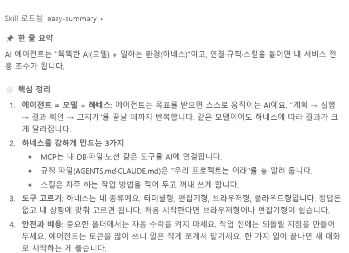

# easy-summary — 비전공자를 위한 쉬운 요약 스킬

만든 사람: 이주연 (모두의연구소 AI 에이전트 3기)

## 왜 만들었나 (불편 → 해결)

| 불편했던 점 | 스킬로 해결한 점 |
|---|---|
| 매일 수업 내용을 정리할 때마다 AI에게 "비전공자도 이해하기 쉽게 정리해서 요약해줘"라고 **같은 말을 반복**했다. | 이 말을 스킬로 저장해 두고 **"쉽게 정리해줘" 한마디**로 끝낸다. |
| 그때그때 결과 모양이 달라서 팀원과 공유하거나 다시 보기 불편했다. | 매번 **같은 양식**(한 줄 요약 → 핵심 3~5개 → 용어 풀이 → 비유 → 해볼 것)으로 나온다. |
| 전문 용어가 그대로 남아 있어 비전공자인 나와 팀원이 다시 찾아봐야 했다. | 용어마다 **쉬운 풀이**를 붙이도록 절차에 넣었다. |

## 폴더 구조

```
my-skills/
├── README.md
├── docs/test-result.png
└── .claude/skills/easy-summary/SKILL.md
```

## 설치 방법

- **Claude Code**: `easy-summary` 폴더를 적용할 프로젝트의 `.claude/skills/easy-summary/` 에 복사
- **Claude 데스크톱(Cowork)**: 설정의 스킬 메뉴에서 SKILL.md를 스킬로 저장
- **Bolt / Replit**: 각 도구의 Skills 메뉴에서 SKILL.md 가져오기 (Replit은 `/.agents/skills/`)

## 호출 문장 (예시)

- "오늘 수업 정리해줘" + 수업 내용 붙여넣기
- "이거 비전공자도 이해하게 쉽게 요약해줘"
- "쉽게 정리해줘"

## 실제 확인한 결과

- 테스트 환경: Claude 데스크톱(Cowork), **새 대화**
- 호출 문장: `쉽게 정리해줘` + 「범용 AI를 '내 전용 조수'로 - 워크플로 강화하기」 수업 내용 붙여넣기
- 결과: 화면에 **"Skill 로드됨 easy-summary"** 가 표시되며 스킬이 자동 발동했고, 정해 둔 양식(📌 한 줄 요약 → 🧩 핵심 정리 …)대로 정리됨
- 확인 날짜: 2026-11-03



결과 일부:

> 📌 **한 줄 요약**
> AI 에이전트는 "똑똑한 AI(모델) + 일하는 환경(하네스)"이고, 연결·규칙·스킬을 붙이면 내 서비스 전용 조수가 됩니다.
>
> 🧩 **핵심 정리**
> 1. 에이전트 = 모델 + 하네스: 목표를 받으면 "계획 → 실행 → 결과 확인 → 고치기"를 반복합니다.
> 2. 하네스를 강하게 만드는 3가지: MCP(도구 연결) · 규칙 파일(AGENTS.md·CLAUDE.md) · 스킬(자주 하는 작업 방법)

> 인증 정보·개인 데이터는 포함하지 않았습니다.
